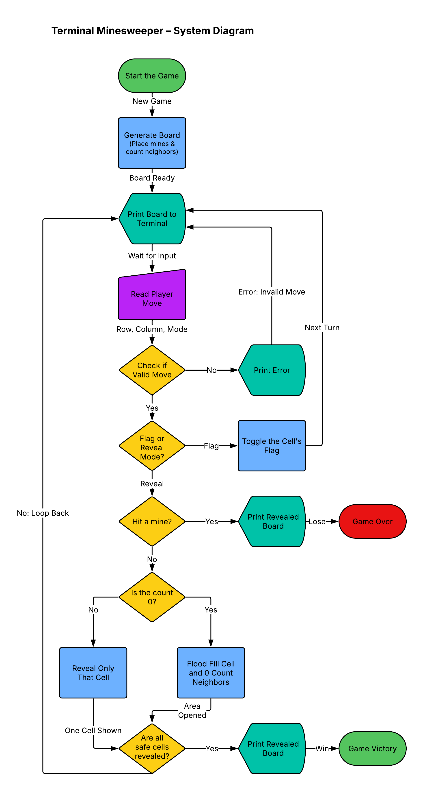

# Terminal Minesweeper

A Minesweeper game you play in the terminal, written in Python.
Built as my CS 193 final project.

## The Problem

I enjoy playing Minesweeper, but I want to play offline and understand the math behind how the game works. I also think building this project will make me better at Minesweeper.

## How It Works

Version 1.0 (MVP) will:

 - Hide 10 mines on a 9x9 board in plain text within the terminal
 - Takes a "mode col row" input; Invalid inputs are rejected with error msg
   - "mode" is either flag or reveal
     - "flag" allows user to mark potential mine locations; "reveal" is user's choice for a safe tile
 - Show how many of the 8 surrounding cells are mines for every revealed cell
 - Automatically open the surrounding area when you reveal a 0 (flood fill)
 - End the game when you reveal a mine (loss) or every safe cell (win)




## Tech Stack

- **Language:** Python 3
- **Libraries:** only `random` for mine placement
- **Data storage:** none; the game state lives in memory as two 2D lists
  (the real board and what the player can see)
- **External tools:** Lucidchart (system diagram)

## Setup

You only need Python 3. Check that it's installed:

```bash
python3 --version
```

Then clone the repo:

```bash
git clone https://github.com/RaphaelSailer/terminal-minesweeper.git
cd terminal-minesweeper
```

## Usage

Start a game:

```bash
python3 minesweeper.py
```

On each turn, type a move:

- `r 3 4` reveals the cell at row 3, column 4
- `f 3 4` flags or unflags the cell at row 3, column 4

## Roadmap

- [ ] First reveal is never a mine
- [ ] Difficulty levels (board size and mine count)
- [ ] Play-again prompt
- [ ] Mines-left counter


## Author

Raphael Sailer · [GitHub](https://github.com/RaphaelSailer)
